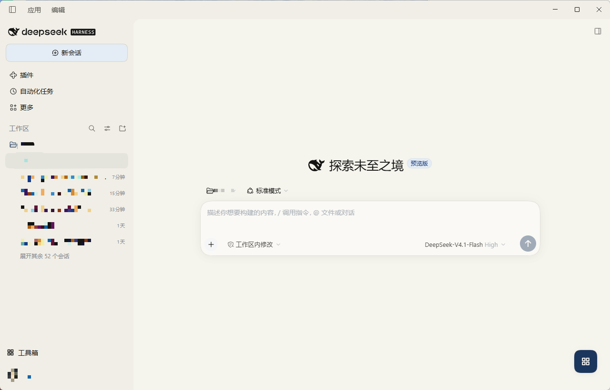

# Kami paper for DeepSeek Harness

A small, dependency-free DSH skin inspired by the color system of [tw93/Kami](https://github.com/tw93/kami). It uses DSH's official theme-token override API rather than replacing application CSS.

## Preview

## Visual language

- Warm parchment `#f5f4ed` as the main canvas
- Ivory `#faf9f5` and warm sand for layered surfaces
- Ink blue `#1B365D` as the restrained primary accent, including links, focus rings, and filled send actions
- Pale ink tints on elevated actions such as New Session, preserving their existing text-color semantics
- Warm near-black and olive-gray text instead of cool blue-grays
- Fine warm borders, with a warm-charcoal adaptation for dark appearance
- Muted semantic colors kept only for success, warning, and error feedback

The plugin changes colors only. It deliberately preserves DSH typography, spacing, controls, icons, and layout. This is a lightweight core-palette override: specialized syntax, chart, file-type, and product-icon colors remain DSH defaults.

## Usage

Install this directory through **Plugins → Add plugin**, or install it with the DSH plugin manager. Enable **Kami paper** to apply the palette. It follows the current light or dark appearance and stacks over the active theme. Disable the bundle to remove every override and restore the previous colors.

No configuration, build step, external font, network request, or personal-data access is required.

## Palette reference

The source palette and design principles come from Kami's [design reference](https://github.com/tw93/Kami/blob/main/skills/kami/references/design.md). This package is an independent adaptation and does not copy Kami's logo or artwork.
